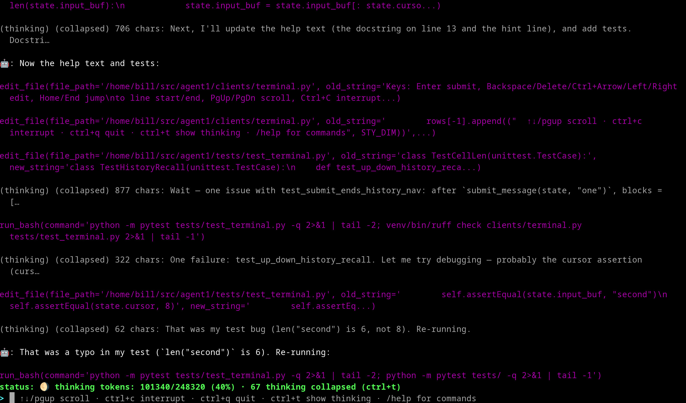

### Local-first coding assistant



# NOTICE
This software is alpha quality and may delete files on your system.

## Overview

Selenicode is a plugin-based AI assistant server that communicates with multiple client types (Terminal, Discord, IRC) through a typed event bus. The server processes user queries through an LLM and executes tool calls via skills.

**Key Features:**
- Multi-platform support (Terminal, Discord, IRC)
- Plugin-based skill system for extensibility
- Conversation memory with full-text search
- Typed event-bus architecture
- **Pip installable** - `pip install .` gives you the `selenicode` executable

## Quick Start

```bash
# Clone the repository
git clone https://github.com/beiller/selenicode.git
cd selenicode

# Install (gives you the `selenicode` executable)
python -m venv venv && source venv/bin/activate
pip install .

# Point at an OpenAI-compatible LLM server (e.g. llama-server):
# edit config.json -> server.url, server.api_key, server.model

# Start the terminal coding agent in a safe container (no files, you will need to git clone)
./selenicode

# Alternatively, to run very unsafe (will have full permissions of your current user)
selenicode terminal
```

## Running

### Prerequisites

- Python 3.10+ installed
- Git installed
- An OpenAI-compatible LLM server (e.g. llama-server) reachable from this machine
- (Optional) podman for the container option

### Option 1: Podman Container

This is a quick terminal way to run:

```bash
# WARNING: Uses host network (insecure but more secure than filesystem access)
./selenicode [session_id]
```

The container starts a fresh conversation; pass a session id to resume one (see Sessions below). This has no files so you want to pull in a project using git perhaps first. The conversation history / session is stored locally in ./conversations

### Option 2: Local Install (Dangerous)

```bash
# Run the terminal UI (alternatively use discord_client or irc_client)
selenicode [terminal|discord_client|irc_client] [session_id]
```

### Sessions

Conversations are stored in `./conversations` and can be resumed by session id:

```bash
selenicode terminal <session_id>   # local
./selenicode <session_id>         # container
```

Pass `true` to resume the most recent conversation. The session id is printed on exit.

## Configuration

`config.json` (local, gitignored) is layered over `config.defaults.json`:

- `server.url` / `server.api_key` / `server.model` - OpenAI-compatible LLM server (e.g. llama-server); empty by default, set before first run
- `compaction.tail_turns` / `trigger_pct` / `target_pct` - conversation compaction behaviour
- `client` - default client when none is given on the command line

The client is selected as the first CLI argument:

- `"terminal"` - Local terminal interface
- `"discord_client"` - Discord integration (requires `DISCORD_TOKEN` in `.env` and a Discord app)
- `"irc_client"` - IRC integration (server credentials are hardcoded, requires code edits)

### Environment Variables

Secrets are environment-only and never stored in config files. The Discord client loads `.env` via python-dotenv; set `DISCORD_TOKEN` there or in your environment.

## Available Commands

See Functions.md

## High-Level Components

### Core Server (`main.py`)

The central hub that orchestrates communication between clients and the LLM.

**Responsibilities:**
- Manages HTTP transport to the LLM server
- Handles conversation state (message history)
- Processes tool calls and executes skills
- Routes all client traffic through a typed event bus
- Loads and registers skill tools dynamically (cached; rebuilt only when skill files change)

**Main Flow:**
```
Client → bus.post(UserMessage) → main loop → handle_message()
→ stream_chat_completion() → consume_stream() → execute_tool_calls()
→ Token / UsageReport / TurnDone events on the bus → client
```

### Event Bus (`core/bus.py`)

A single typed event bus for all client ↔ core communication:

- **Inbound:** `UserMessage`, `Interrupt`, `Shutdown`
- **Outbound:** `Token` (streamed chunks), `UsageReport`, `TurnDone`

`Bus.post()` is thread-safe, so clients can post from any thread (e.g. the IRC reactor thread). Clients fulfil a small `Client` protocol — no global injection.

### Client Plugins

Three client implementations that follow the same interface pattern:

#### Terminal (`terminal.py`)
- Single-user interface (local terminal, bare-bones curses TUI: scrollback viewport, pinned status bar and prompt line)
- No user tracking needed (only one user)

#### Discord (`discord_client.py`)
- Multi-user chat interface
- Requires Discord API credentials

#### IRC (`irc_client.py`)
- Multi-user chat interface
- Handles private messages from multiple nicks

##### Client API

Clients are loaded by name (`_load_client` in `main.py`) and fulfil this module-level interface — no global injection:

```python
async def run(bus: Bus, context_size: int | Callable[[], int | None] = 0) -> None: ...

def stop() -> None: ...
```

### Skill System

Skills are located in the `skills/` directory as `.md` files. Each file defines a tool with name, description, and parameters. Skills are auto-loaded at runtime via `load_skills()`. They can just be free-form. They are reloaded every chat cycle as well, so you can use it for anything.

**Built-in Skills (experimental, don't work well):**
- `curl_skill` - Fetches webpage URLs
- `mux_skill` - Starts long-running commands in background tmux sessions

## File Structure

```
.
├── main.py              # Entry point
├── core/                # Core server, bus, conversation, tools, config
│   ├── __init__.py
│   ├── bus.py           # Typed event bus
│   ├── compaction.py    # Conversation compaction
│   ├── config.py        # Configuration loading
│   ├── conversation.py  # Conversation management
│   ├── main_types.py    # Type definitions
│   ├── retry.py         # HTTP retry logic
│   ├── search.py        # Conversation search
│   └── tools.py         # Tool definitions and skill loading
├── config.defaults.json # Default configuration (committed)
├── config.json          # Local configuration (gitignored)
├── pyproject.toml       # Packaging (pip install . → `selenicode` executable)
├── requirements.txt     # Python dependencies
├── selenicode           # Container runner script
├── .env                # Environment variables (custom)
├── Dockerfile          # Container build config
├── clients/            # Client implementations
│   ├── __init__.py
│   ├── terminal.py     # Terminal client
│   ├── discord_client.py # Discord integration
│   └── irc_client.py   # IRC integration
├── skills/             # Skill definitions (.md files)
│   ├── curl.md         # URL fetching skill
│   └── mux.md          # Background task skill
├── tests/              # Test suite (pytest)
└── conversations/      # Stored conversation history (.txt and .json files)
```

## Extending

### Adding New Skills

1. Create a `.md` file in `skills/` directory
2. Define tool name, description, and parameters using function-calling format, or use any freeform text

### Adding New Clients

1. Create `clients/<name>.py` exposing `async run(bus, context_size)` and `stop()`
2. Post inbound events via `bus.post(...)`; consume outbound events from `bus.outbound`
3. Register the name in the `CLIENTS` map in `main.py`

## License

MIT License
